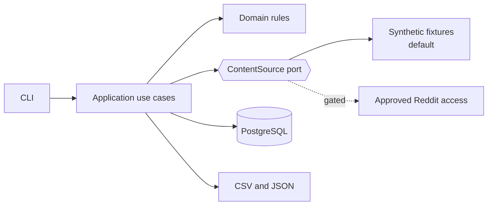

# Reddit Insight Engine

A compliance-first Python platform for collecting, storing and analyzing data from developer,
DevOps, SRE, cloud, security and AI communities, using only approved access to Reddit.

> **Project status: Phase 1 of 7.** This repository currently holds architecture, standards and
> a tested package skeleton. It has no collection features yet, and it holds no Reddit
> credentials or approval.

## Important: Reddit access

Reddit's changelog states that new public Data API requests closed on 31 October 2026 and that
remaining public access ends in March 2027. Reddit also directs research use to its Reddit for
Researchers program. This project therefore treats real access as unavailable by default.

It runs against synthetic fixtures, and the real adapter stays off unless an operator confirms
approval. See [assumptions and risks](docs/architecture/assumptions.md) and
[compliance](docs/architecture/compliance.md).

## Design at a glance



- **Modular monolith** with four layers, enforced by automated import contracts.
- **Works with no credentials** through a fixture data source.
- **Idempotent and recoverable:** replays are safe, and interrupted runs resume.
- **Privacy by design:** usernames are pseudonymized, and deletion and retention are built in.

## Quick start

Requires [uv](https://docs.astral.sh/uv/).

```bash
uv sync --frozen
bash scripts/check.sh
```

## Roadmap

| Phase | Scope | Status |
| --- | --- | --- |
| 1 | Requirements, architecture, threat model, standards | Current |
| 2 | Domain models, use cases, interfaces, dependency injection | Planned |
| 3 | Reddit adapter, OAuth, mock adapter, pagination, rate limits, retries | Planned |
| 4 | Validation, deduplication, PostgreSQL, migrations | Planned |
| 5 | Automated tests and quality checks | Planned |
| 6 | Docker, Compose, CI/CD, security scanning | Planned |
| 7 | Observability, operations docs, production readiness | Planned |

## Documentation

- [Requirements](docs/architecture/requirements.md)
- [Assumptions and risks](docs/architecture/assumptions.md)
- [Architecture overview](docs/architecture/overview.md)
- [Threat model](docs/architecture/threat-model.md)
- [Compliance](docs/architecture/compliance.md)
- [Architecture decision records](docs/adr/README.md)
- [Local setup](docs/operations/local-setup.md)
- [Configuration](docs/operations/configuration.md)
- [Contributing](CONTRIBUTING.md)
- [Security policy](SECURITY.md)
