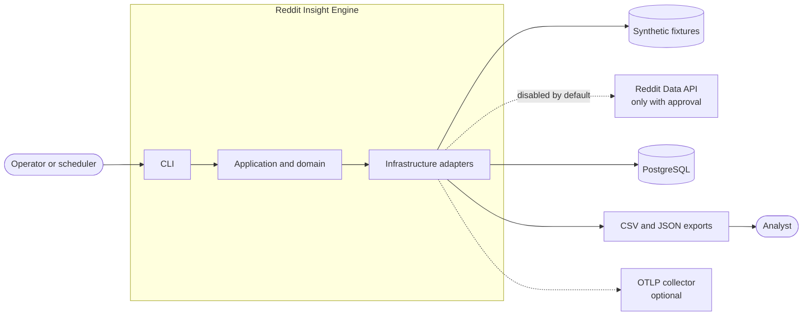
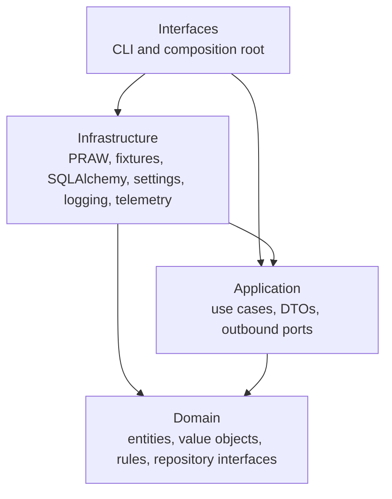
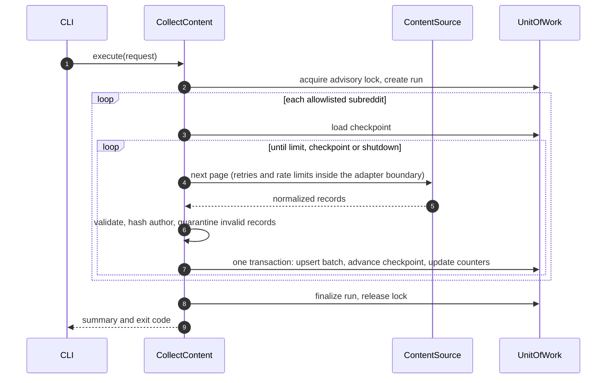
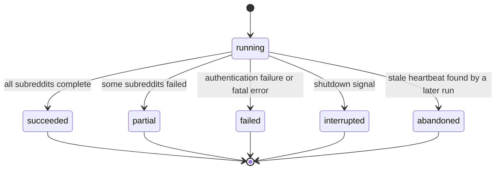
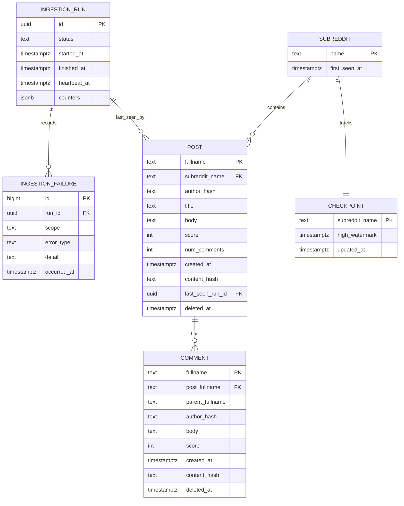

# Architecture Overview

The system is a modular monolith organized in four layers, run as a batch CLI against
PostgreSQL. Reasoning and trade-offs are in the [ADRs](../adr/README.md). Component names
describe the design; implementation begins in Phase 2.

## System context



## Layers

Dependencies point inward only. `import-linter` enforces this on every check.



| Layer | Owns | May import |
| --- | --- | --- |
| Domain | `Post`, `Comment`, `IngestionRun`, `Fullname`, `SubredditName`, repository protocols, domain errors | Standard library |
| Application | Use cases, immutable DTOs, `ContentSource`, `Clock`, `UnitOfWork`, `Telemetry` ports | Domain, Pydantic for DTO validation |
| Infrastructure | Adapter implementations | Application, domain, third-party libraries |
| Interfaces | Argument parsing, exit codes, object wiring | All layers |

Dependency injection is explicit constructor injection, wired by hand in one composition root
in the interfaces layer. A container framework would add indirection without solving a problem
at this size.

## Primary ports

| Port | Purpose | Adapters |
| --- | --- | --- |
| `ContentSource` | Read-only: iterate posts, fetch comments, look up status by fullname | Fixture, PRAW |
| `UnitOfWork` and repositories | Transactional persistence | SQLAlchemy |
| `Exporter` | Write CSV or JSON with a manifest | Filesystem |
| `Telemetry` | Metrics and spans | OpenTelemetry, no-op |
| `Clock` and `Sleeper` | Deterministic time in tests | System, fake |

## Planned use cases

| Use case | Summary |
| --- | --- |
| `CollectContent` | Run a collection across the allowlist |
| `ReconcileDeletions` | Detect upstream deletions and purge local content |
| `EnforceRetention` | Purge content past the retention window, and expired exports |
| `ExportData` | Produce pseudonymized CSV or JSON |
| `SummarizeCommunities` | Compute analytics with SQL |
| `InspectRuns` | Show runs, failures and checkpoints |

## Collection flow



Advancing the checkpoint in the same transaction as the data is the key property. A crash at
any point leaves the two consistent, so a rerun cannot lose or corrupt records.

## Ingestion run lifecycle



## Failure policy

Adapters translate library exceptions into these domain errors, so PRAW types never cross the
port.

| Error | Example | Behavior |
| --- | --- | --- |
| `TransientSourceError` | Timeout, server error | Retry with bounded backoff and full jitter |
| `RateLimitedError` | Limit exceeded with a stated wait | Wait as instructed, within the attempt budget |
| `AuthenticationError` | Invalid or revoked credentials | Fail the run at once; never retry |
| `PermissionDeniedError` | Private or restricted subreddit | Record, skip that subreddit, continue |
| `NotFoundError` | Banned or missing subreddit | Record, skip, continue |
| `RecordValidationError` | Malformed record | Quarantine metadata, continue |

## Data model

Only these fields are persisted. Raw API payloads and raw usernames are never stored.



## Key mechanisms

- **Idempotency:** `INSERT ... ON CONFLICT (fullname) DO UPDATE`, applied only when
  `content_hash` differs. Replaying a batch changes nothing.
- **Incremental collection:** read newest first and stop at the high watermark minus
  `RIE_COLLECT_OVERLAP_MINUTES`. The overlap absorbs ordering jitter, and idempotent writes make
  the re-read harmless.
- **Late comments:** posts inside a refresh window have their comments re-collected, because a
  post watermark cannot detect new comments on older posts.
- **Tombstones:** a purge nulls author, title and body and sets `deleted_at`. The row stays, so
  a later replay cannot restore deleted content.
- **Shutdown:** signal handlers set a flag checked between batches. The current transaction
  commits, the run is marked `interrupted`, and the next run resumes from the checkpoint.
- **Single runner:** a PostgreSQL advisory lock prevents overlapping collections. Stale `running`
  rows are marked `abandoned` once the lock is acquired.

## Repository structure

```text
src/reddit_insight/
  domain/            entities, value objects, rules, repository interfaces
  application/       use cases, DTOs, outbound ports
  infrastructure/    source adapters, database, configuration, logging, telemetry
  interfaces/        CLI and composition root
tests/
  unit/              fast tests with no I/O
  integration/       tests against real PostgreSQL
  fixtures/          synthetic data only
docs/
  architecture/      requirements, assumptions, design, threat model, compliance
  adr/               architecture decision records
  operations/        setup, configuration, deployment, runbooks
scripts/             developer and operator scripts
docker/              image and Compose definitions
.github/workflows/   CI and security checks
```
