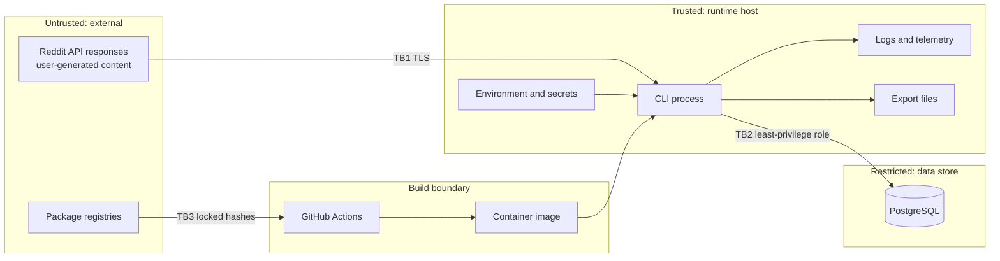

# Threat Model

Method: STRIDE over the data flows below, reviewed at each phase. Last reviewed 2026-11-09.
All mitigations are **planned** unless marked **in place**.

## Assets

| ID | Asset | Why it matters |
| --- | --- | --- |
| AS-1 | Reddit OAuth credentials | Abuse could cost the project its access |
| AS-2 | Author hash key | Exposure allows usernames to be confirmed against hashes |
| AS-3 | Database credentials and contents | Holds retained user-generated content |
| AS-4 | Exports | Copies of data outside deletion controls |
| AS-5 | Build pipeline and dependencies | Compromise runs code with access to all secrets |
| AS-6 | Compliance standing | Breaching terms risks access and legal exposure |

## Data flows and trust boundaries

## Threats and mitigations

| ID | STRIDE | Threat | Asset | Mitigation | Phase |
| --- | --- | --- | --- | --- | --- |
| T-01 | Info disclosure | Secrets committed to Git | AS-1, 2, 3 | Ignored `.env`, gitleaks hook (**in place**), secret scan in CI | 1, 6 |
| T-02 | Info disclosure | Secrets appear in logs or exceptions | AS-1, 2, 3 | `SecretStr` settings, log redaction processor, test asserting redaction | 3, 7 |
| T-03 | Info disclosure | Secrets baked into image layers | AS-1, 2, 3 | Runtime injection, `.dockerignore`, multi-stage build | 6 |
| T-04 | Elevation | Over-privileged Reddit credentials | AS-1, 6 | Application-only OAuth; no password setting exists | 3 |
| T-05 | Elevation | Over-privileged database role | AS-3 | Separate migration and runtime roles | 4, 7 |
| T-06 | Tampering | SQL injection through content | AS-3 | Bound parameters through SQLAlchemy; no string-built SQL | 4 |
| T-07 | Tampering | Spreadsheet formula injection through CSV export | AS-4 | Neutralize cells beginning with `=`, `+`, `-`, `@`, tab or carriage return | 4 |
| T-08 | Tampering | Log injection from user content | AS-6 | Structured JSON encoding; content is not logged | 7 |
| T-09 | Denial of service | Oversized or malformed payload | AS-3 | Field length limits, validation, quarantine | 4 |
| T-10 | Denial of service | Retry storm against Reddit | AS-6 | Bounded attempts, jitter, run-wide failure budget | 3 |
| T-11 | Elevation | Malicious dependency | AS-5 | Hashed lockfile, audit, SBOM, pinned Actions | 1, 6 |
| T-12 | Elevation | Malicious pull request reaches CI secrets | AS-5 | Least-privilege `GITHUB_TOKEN`; no secrets on fork PRs | 6 |
| T-13 | Info disclosure | Real data reaches Git or fixtures | AS-4, 6 | Ignore rules (**in place**), synthetic-only fixture rule (**in place**) | 1 |
| T-14 | Info disclosure | Exports outlive their permission | AS-4, 6 | Manifest with expiry, purge command | 4 |
| T-15 | Info disclosure | Usernames recovered from hashes | AS-2 | Keyed HMAC, not a plain hash; key stored apart from data | 4 |
| T-16 | Info disclosure | Deleted content lingers | AS-6 | Reconciliation, tombstones, backup lifetime limits | 4, 7 |
| T-17 | Repudiation | Unable to show what was collected and when | AS-6 | Immutable run and failure records | 4 |
| T-18 | Spoofing | Traffic to a fake endpoint | AS-1 | TLS verification left on; endpoints not configurable | 3 |
| T-19 | Elevation (compliance) | Real source enabled by accident | AS-6 | Fixture default, acknowledgement gate, credentials required | 2, 3 |
| T-20 | Elevation (compliance) | Collection beyond approved scope | AS-6 | Allowlist enforced before any source call; collection limits | 2, 3 |

## Accepted risks

| Risk | Rationale | Revisit when |
| --- | --- | --- |
| Environment variables are readable by same-user processes | Acceptable for single-tenant local and batch use | Multi-tenant hosting |
| Text fields may contain personal details users posted themselves | Filtering is unreliable; retention and deletion limit exposure | Real data is enabled |
| Exports cannot be recalled after distribution | Inherent; manifest states the obligation | External sharing is proposed |
